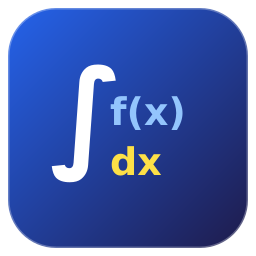

<div align="center">

[English](README.md) | [Tiếng Việt](README.vi.md)

<br />
<br />



# MathWeave Studio

**An interactive mathematical workspace for pedagogical step-by-step solutions, independent symbolic verification, and 2D/3D visualization.**

*MathWeave Studio is designed to help students and researchers understand mathematical reasoning and transformation rules, rather than treating computer algebra as a black-box answer engine.*

[](LICENSE)
[](https://www.python.org/)
[](https://github.com/TqvNoCode/MathWeave-Studio/releases/latest)

</div>

---

## Table of Contents

- [Overview](#overview)
- [Features](#features)
  - [Calculus](#calculus)
  - [Differential Equations (ODE)](#differential-equations-ode)
  - [Linear Algebra](#linear-algebra)
  - [Verification & Rationale](#verification--rationale)
  - [Workspaces & UI Experience](#workspaces--ui-experience)
  - [Visualization](#visualization)
- [Installation](#installation)
  - [Quick Start (Linux via uv)](#quick-start-linux-via-uv)
  - [Windows Standalone Desktop Application](#windows-standalone-desktop-application)
  - [Building on Windows from Source](#building-on-windows-from-source)
- [Documentation](#documentation)
- [Development & Testing](#development--testing)
- [License & Author](#license--author)

---

## Overview

Most mathematical software outputs only a final answer, leaving learners unsure of how a solution was derived or whether intermediate steps are mathematically sound.

MathWeave Studio bridges this gap by combining:
- **Symbolic Computation:** Mathematical expression manipulation and exact arithmetic powered by SymPy.
- **Pedagogical Derivation Engine:** Step-by-step decomposition of standard calculus and differential equation rules with expandable substeps.
- **Native MathML & Shared LaTeX Rendering:** Clear rendering of inline and display mathematics across all problem categories via secure, sanitized native MathML.
- **Independent Verification:** Independent verification using symbolic invariants and multi-point numerical probing where supported.
- **Interactive Visualization:** 2D function plotting with automatic pole and asymptote detection, standardized 3D surface visualization, and variation tables (*bảng biến thiên*).

---

## Features

### Calculus
- **Derivatives:** First-order and higher-order derivatives ($f^{(n)}(x)$ up to order 10) and partial derivatives ($\frac{\partial f}{\partial x}$, $\frac{\partial f}{\partial y}$).
- **Integrals:** Indefinite integration with rule breakdown and integration constant $+ C$; definite integrals over $[a, b]$ via the Fundamental Theorem of Calculus.
- **Limits:** Two-sided and one-sided limits ($\lim_{x \to a^{\pm}}$) at finite points and infinities ($\pm\infty$).
- **Geometry & Multivariable:** Arc length, surface area, surfaces/solids of revolution, line and surface integrals, and triple integrals (Cartesian, cylindrical, spherical).

### Differential Equations (ODE)
- **First-Order Linear ODEs ($y' = ay + b$ & $y' + p(t)y = g(t)$):** Constant & variable coefficients with integrating factors ($\mu(t) = e^{\int p(t)dt}$) and equilibrium solution preservation.
- **Separable Equations ($y' = f(t)g(y)$):** Validated separation of variables with preservation of all equilibrium roots ($g(y) = 0$).
- **Exact Differential Equations ($M(x, y)dx + N(x, y)dy = 0$):** Exactness condition check ($\frac{\partial M}{\partial y} = \frac{\partial N}{\partial x}$) and potential function construction ($F(x, y) = C$).
- **Integrating Factors ($\mu(x)$ / $\mu(y)$):** Conversion of non-exact equations into exact differential equations.
- **Second-Order Constant-Coefficient ODEs ($ay'' + by' + cy = 0$):** Characteristic polynomial analysis ($ar^2 + br + c = 0$), discriminant classification ($\Delta > 0$ distinct real, $\Delta < 0$ complex conjugate via Euler's formula, $\Delta = 0$ repeated root with factor $t$), fundamental solution sets, and independent verification.
- **Second-Order Nonhomogeneous ODEs ($ay'' + by' + cy = g(t)$):** Particular solutions via the Method of Undetermined Coefficients (MUC) with resonance factor $t^s$, and Variation of Parameters (VoP) via Wronskian integration.
- **Homogeneous Second-Order Euler–Cauchy ODEs ($a t^2 y'' + b t y' + c y = 0$):** Indicial equation analysis across distinct real, repeated real ($\ln|t|$), and complex conjugate ($\cos(\beta\ln|t|), \sin(\beta\ln|t|)$) roots with connected branch separation ($t > 0$, $t < 0$) and singular-point guards at $t = 0$.
- **Second-Order Initial Value Problems (Cauchy IVP):** Dual initial conditions $y(t_0) = y_0$ and $y'(t_0) = v_0$ for both homogeneous and nonhomogeneous systems ($y = y_h + y_p$) with 2x2 linear system resolution for $C_1, C_2$ and independent verification.
- **Singular Cauchy IVPs & Domain Branching:** Decomposition into connected normalized domain intervals, anchored integrating factors ($\mu_{t_0}(t) = e^{\int_{t_0}^t p(s)ds}$) avoiding cross-singularity leakage, algebraic compatibility analysis at singular points, and smooth $C^1$ extension verification.
- **Reduction of Order:** Derivation of second fundamental solution $y_2(t) = v(t)y_1(t)$ from verified non-zero $y_1(t)$ via first-order reduction $u = v'$ and integral formula $u(t) = \frac{e^{-\int p(t)dt}}{y_1(t)^2}$, with domain singularity detection.
- **Wronskian Determinant ($W(y_1, y_2)$):** Linear independence auditing and Abel's identity validation.

### Linear Algebra
- **Determinants:** $2 \times 2$ formula and Laplace expansion for higher-order matrices.
- **Matrix Inverses ($A^{-1}$):** Invertibility checks ($\det A \ne 0$) and adjugate matrix calculation.
- **Echelon Forms:** Gaussian elimination (REF) and Gauss-Jordan elimination (RREF) with elementary row operations.
- **Matrix Operations:** Addition, subtraction, multiplication ($A \times B$), and transpose ($A^T$).
- **Linear Systems ($Ax = b$):** Augmented matrix $[A | b]$ solving with complete solution classification.

### Verification & Rationale
- **Multi-Level Auditing & Pedagogical Badges:** Results display transparent verification status badges (*Verified*, *Partially Verified*, *Conditional Extension*, *Numerical Probe* sampling with error $< 10^{-9}$, or *Failed*). Verification status communicates the actual level of confidence rather than assuming universal correctness.
- **Tri-State Validation & Domain Restrictions ($\mathcal{D}$):** Enforces fail-closed tri-state validation (`valid`, `invalid`, `unknown`). Unresolved symbolic conditions or indeterminate limits are reported honestly as `UNVERIFIED`. Source-level domain restrictions (non-zero denominators, non-negative radical constraints, trigonometric poles) are preserved before algebraic simplification where supported.
- **Singular Extension Verification:** Limit evaluation and derivative compatibility across singular branch interfaces without arbitrary constant assignment.

### Workspaces & UI Experience
- **Dedicated Workspaces & Unified Design System:** Specialized, accessible interfaces across all 34 operations for Calculus, Linear Algebra, and First/Second-Order ODEs with automatic equation-first classification and expandable manual overrides.
- **Operation Catalog & Deep Linking:** Searchable operation launcher with category filtering, quick-launch chips, and direct URL query parameter pre-filling (`?op=ode&eq=...`).
- **Structured Pedagogical Flows:** Stage-by-stage derivation pipelines (Formulation $\to$ Homogeneous $\to$ Particular $\to$ Superposition $\to$ Cauchy IVP $\to$ Independent Verification) with collapsible substeps.

### Visualization
- **2D Plotting (Plotly):** Interactive graphs with zoom, pan, and automatic pole detection to prevent invalid line connections across vertical asymptotes.
- **3D Visualization:** Isometric 3D surfaces and space curves with RGB coordinate axes (X=Red, Y=Green, Z=Blue).
- **Variation Tables:** Academic variation tables showing domain $\mathcal{D}$, critical points, poles (double bar `||`), derivative signs, and monotonicity arrows.

---

## Installation

MathWeave Studio is designed to run as a **native desktop application by default on supported Linux desktop environments and Windows**, while supporting an explicit `--browser` mode for headless workflows.

### Quick Start (Linux via uv)

1. **Clone the repository:**
   ```bash
   git clone https://github.com/TqvNoCode/MathWeave-Studio.git
   cd MathWeave-Studio
   ```

2. **Synchronize dependencies:**
   ```bash
   uv sync
   ```
   *(On Linux, `uv sync` automatically installs `pywebview[qt]` with PyQt6 and QtWebEngine).*

3. **Launch the application:**
   - **Native Desktop Window (Default):**
     ```bash
     uv run run.py
     ```
     Opens MathWeave Studio in a standalone native desktop window on X11 or Wayland (Arch Linux KDE Plasma, GNOME, Ubuntu, Debian).
   - **Browser Mode:**
     ```bash
     uv run run.py --browser
     ```
     Launches the UI directly in your default web browser at **[http://localhost:8080](http://localhost:8080)**. Ideal for headless environments, remote servers, or CI test runners.

> **System Prerequisites for Linux Native Mode:**
> MathWeave Studio utilizes a Qt6 / QtWebEngine backend via pywebview. Ensure the following system packages are installed:
> - **Arch Linux:** `sudo pacman -S --needed qt6-webengine qt6-webchannel`
> - **Ubuntu / Debian:** `sudo apt install -y libgl1 libegl1 libxkbcommon0 libdbus-1-3 libxcb1 libxcb-cursor0`
> - **Known Backend Limitation:** Native desktop mode requires an active graphical display session (`DISPLAY` or `WAYLAND_DISPLAY`). In headless environments without a display server, launch with `--browser`.

For complete Arch Linux instructions—including future AUR installation placeholders, system dependencies, running with standard virtual environments, and uninstallation—see the [Arch Linux Installation Guide](docs/INSTALL_ARCH.md).

### Windows Standalone Desktop Application

Download the official Windows packages from the **[MathWeave Studio GitHub Releases](https://github.com/TqvNoCode/MathWeave-Studio/releases/latest)** ([All Releases](https://github.com/TqvNoCode/MathWeave-Studio/releases)):
- **Portable Standalone Executable:** `MathWeave-Studio-Portable-Unsigned-Dev.exe` — Single-file executable ready to run immediately without installation.
- **Windows Installer:** `MathWeave-Studio-Setup-Unsigned-Dev.exe` — Standard Windows setup wizard configuring Start Menu and optional Desktop shortcuts with full uninstaller support.
- **Integrity Checksums:** `SHA256SUMS.txt` (published alongside the release assets).

Double-click either package to launch MathWeave Studio directly in a native desktop window without requiring Python or uv to be installed.

> [!NOTE]
> **Code Signing Transparency:**
> The prebuilt Windows binaries above are unsigned development builds (`Unsigned-Dev`) and are not signed with a commercial Authenticode certificate. Windows SmartScreen or antivirus software may present an *"Unknown Publisher"* warning on first launch. To run the portable application, select **More info** $\to$ **Run anyway**, or verify the downloaded file against `SHA256SUMS.txt`.

> **System Prerequisites for Windows Native Mode:**
> MathWeave Studio utilizes Microsoft Edge WebView2 for its native desktop window. WebView2 is pre-installed on Windows 11 and modern Windows 10 versions. If running on a stripped or offline Windows edition without WebView2, install the official [Microsoft Edge WebView2 Evergreen Runtime](https://go.microsoft.com/fwlink/p/?LinkId=2124703), or launch with `--browser` from the command prompt.

#### Building on Windows from Source

MathWeave Studio supports building both a standalone portable binary and a full setup installer using Python 3.14+:

```powershell
# Synchronize all dependency groups including dev and packaging tools
uv sync --all-groups

# 1. Build Standalone Portable Executable (Single-file EXE):
uv run pyinstaller mathweave-studio-onefile.spec --clean --noconfirm

# 2. Build Directory Distribution (Onedir) for Installer Packaging:
uv run pyinstaller mathweave-studio.spec --clean --noconfirm

# 3. Compile Windows Setup Installer (Requires Inno Setup 6 / ISCC.exe):
$version = uv run python -c "from build_tools.generate_version_info import get_project_version; print(get_project_version())"
$author = uv run python -c "from build_tools.generate_version_info import get_project_author; print(get_project_author())"
ISCC.exe /DMyAppVersion="$version" /DMyAppPublisher="$author" /DMyOutputBaseFilename="MathWeave-Studio-Setup-Unsigned-Dev" installer/MathWeave-Studio.iss
```

---

## Documentation

- 🐧 **[Arch Linux Installation Guide (INSTALL_ARCH.md)](docs/INSTALL_ARCH.md):** Detailed guide for Arch Linux users, yay/AUR status, source setup, and clean uninstallation.
- 📖 **[User Guide (USER_GUIDE.md)](docs/USER_GUIDE.md):** Complete practical guide covering the 5-step workflow, representative examples, input syntax, and troubleshooting.

---

## Development & Testing

MathWeave Studio maintains an automated test suite enforcing Clean Architecture boundary isolation, solver mathematical validity, edge-case regressions, and UI stability:

```bash
# Run the full automated test suite
uv run pytest -q
```

The test suite executes unit, acceptance, and architectural tests across all supported modules. While extensive automated testing validates implemented algorithms and prevents regressions, passing tests do not constitute a formal mathematical proof for all arbitrary symbolic expressions.

---

## License & Author

- **License:** GNU General Public License v3.0 ([GPL-3.0](LICENSE)).
- **Author:** TQV (`TqvNoCode` — `92263302+TqvNoCode@users.noreply.github.com`)
- **Copyright:** `© 2026 by TQV`
