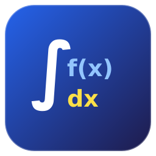

<div align="center">

[English](README.md) | [Tiếng Việt](README.vi.md)

<br />
<br />



# MathWeave Studio

**Không gian làm việc toán học tương tác hỗ trợ giải toán từng bước sư phạm, kiểm chứng ký hiệu độc lập và trực quan hóa 2D/3D.**

*MathWeave Studio được xây dựng nhằm giúp học sinh, sinh viên và người nghiên cứu thấu hiểu chuỗi lập luận và quy tắc biến đổi toán học, thay vì xem phần mềm tính toán như một "hộp đen" chỉ trả về đáp số cuối cùng.*

[](LICENSE)
[](https://www.python.org/)
[](https://github.com/TqvNoCode/MathWeave-Studio/releases/latest)

</div>

---

## Mục lục

- [Tổng quan dự án](#tổng-quan-dự-án)
- [Các tính năng chính](#các-tính-năng-chính)
  - [Giải tích](#giải-tích-calculus)
  - [Phương trình vi phân](#phương-trình-vi-phân-differential-equations)
  - [Đại số tuyến tính](#đại-số-tuyến-tính-linear-algebra)
  - [Kiểm chuẩn & Ràng buộc toán học](#kiểm-chuẩn--ràng-buộc-toán-học)
  - [Không gian làm việc & Trải nghiệm giao diện](#không-gian-làm-việc--trải-nghiệm-giao-diện)
  - [Trực quan hóa & Bảng biến thiên](#trực-quan-hóa--bảng-biến-thiên)
- [Cài đặt và Khởi động nhanh](#cài-đặt-và-khởi-động-nhanh)
  - [Khởi động nhanh (Linux qua uv)](#khởi-động-nhanh-linux-qua-uv)
  - [Ứng dụng Desktop Độc lập trên Windows](#ứng-dụng-desktop-độc-lập-trên-windows)
  - [Đóng gói trên Windows từ Mã nguồn](#đóng-gói-trên-windows-từ-mã-nguồn)
- [Tài liệu dự án](#tài-liệu-dự-án)
- [Phát triển và Bộ kiểm thử](#phát-triển-và-bộ-kiểm-thử)
- [Bản quyền & Tác giả](#bản-quyền--tác-giả)

---

## Tổng quan dự án

Hầu hết các phần mềm toán học hiện nay chỉ đưa ra đáp án sau cùng, khiến người học gặp khó khăn trong việc hiểu rõ cách thức dẫn đến kết quả hoặc kiểm chứng tính đúng đắn của từng bước trung gian.

MathWeave Studio giải quyết vấn đề này bằng cách kết hợp:
- **Đại số biểu tượng:** Thao tác biểu thức toán học và số học chính xác được hỗ trợ bởi SymPy.
- **Bộ máy phân rã từng bước sư phạm:** Tách bạch các quy tắc giải tích và phương trình vi phân chuẩn mực kèm các bước con (*Substeps*) có thể mở rộng.
- **Hiển thị toán học MathML & LaTeX an toàn:** Hiển thị công thức toán học nội dòng và độc lập bằng MathML chuẩn, tự động làm sạch và bảo mật chống tấn công XSS.
- **Kiểm chuẩn độc lập:** Đối chiếu kiểm chứng độc lập bằng đối chiếu đại số biểu tượng và lấy mẫu số học đa điểm (*Numerical Probing*) tại các bài toán được hỗ trợ.
- **Trực quan hóa tương tác:** Đồ thị hàm số 2D tự động phát hiện tiệm cận và điểm gián đoạn, đồ thị mặt cong 3D chuẩn màu hệ trục và bảng biến thiên toán học (*variation tables*).

---

## Các tính năng chính

### Giải tích (Calculus)
- **Đạo hàm:** Đạo hàm bậc 1 và cấp cao $f^{(n)}(x)$ (từ cấp 1 đến cấp 10); đạo hàm riêng hàm nhiều biến ($\frac{\partial f}{\partial x}$, $\frac{\partial f}{\partial y}$).
- **Tích phân:** Nguyên hàm (tích phân bất định) kèm quy tắc và hằng số tích phân $+ C$; tích phân xác định trên đoạn $[a, b]$ theo định lý cơ bản của giải tích (Newton–Leibniz).
- **Giới hạn hàm số (Limits):** Giới hạn hai phía và một phía ($\lim_{x \to a^{\pm}}$) tại điểm hữu hạn và vô cực ($\pm\infty$).
- **Giải tích đa biến & Hình học:** Độ dài cung, diện tích mặt cong, mặt/khối tròn xoay, tích phân đường, tích phân mặt và tích phân khối (Descartes, trụ, cầu).

### Phương trình vi phân (Differential Equations)
- **Phương trình tuyến tính cấp 1 ($y' = ay + b$ & $y' + p(t)y = g(t)$):** Hệ số hằng và hệ số biến với phương pháp thừa số tích phân ($\mu(t) = e^{\int p(t)dt}$) và bảo toàn nghiệm cân bằng.
- **Phương trình tách biến ($y' = f(t)g(y)$):** Phân tách biến số an toàn, bảo toàn nghiệm cân bằng từ phương trình $g(y) = 0$.
- **Phương trình vi phân toàn phần ($M(x, y)dx + N(x, y)dy = 0$):** Kiểm tra điều kiện vi phân toàn phần ($\frac{\partial M}{\partial y} = \frac{\partial N}{\partial x}$) và xây dựng hàm thế $F(x, y) = C$.
- **Thừa số tích phân ($\mu(x)$ / $\mu(y)$):** Chuyển đổi phương trình không toàn phần về toàn phần.
- **Phương trình vi phân cấp 2 hệ số hằng ($ay'' + by' + cy = 0$):** Phân tích đa thức đặc trưng ($ar^2 + br + c = 0$), phân loại biệt thức ($\Delta > 0$ hai nghiệm thực phân biệt, $\Delta < 0$ nghiệm phức liên hợp qua công thức Euler, $\Delta = 0$ nghiệm kép với thừa số nhân $t$), xây dựng hệ nghiệm cơ bản và kiểm chứng độc lập.
- **Phương trình vi phân cấp 2 không thuần nhất ($ay'' + by' + cy = g(t)$):** Tìm nghiệm riêng qua Phương pháp Hệ số bất định (MUC) với nhân tử cộng hưởng $t^s$, và Phương pháp Biến thiên hằng số (VoP) qua tích phân Wronskian.
- **Phương trình vi phân Euler–Cauchy thuần nhất ($a t^2 y'' + b t y' + c y = 0$):** Phân tích phương trình đặc trưng chỉ số qua ba trường hợp nghiệm thực phân biệt, nghiệm kép ($\ln|t|$) và nghiệm phức liên hợp ($\cos(\beta\ln|t|), \sin(\beta\ln|t|)$) với phân nhánh liên thông ($t > 0$, $t < 0$) và bảo vệ điểm kỳ dị $t = 0$.
- **Bài toán Cauchy cấp 2 (Second-Order IVP):** Hệ hai điều kiện ban đầu $y(t_0) = y_0$ và $y'(t_0) = v_0$ cho cả phương trình thuần nhất và không thuần nhất ($y = y_h + y_p$), giải hệ đại số $2 \times 2$ tìm $C_1, C_2$ và kiểm chứng độc lập.
- **Phân tích miền kỳ dị & Bài toán Cauchy tại điểm kỳ dị:** Phân rã miền xác định thành các nhánh chính quy liên thông, thừa số tích phân neo chuẩn tắc ($\mu_{t_0}(t) = e^{\int_{t_0}^t p(s)ds}$) tránh tích phân xuyên điểm cực, biện luận tương thích đại số và kiểm chứng nối trơn $C^1$ qua điểm kỳ dị.
- **Phương pháp hạ bậc (Reduction of Order):** Dẫn xuất nghiệm cơ bản thứ hai $y_2(t) = v(t)y_1(t)$ từ nghiệm đã biết $y_1(t)$ qua phương trình vi phân cấp một $u = v'$ và công thức tích phân $u(t) = \frac{e^{-\int p(t)dt}}{y_1(t)^2}$, kèm phát hiện điểm kỳ dị và miền xác định.
- **Định thức Wronskian ($W(y_1, y_2)$):** Kiểm tra tính độc lập tuyến tính của hệ nghiệm cơ bản và kiểm chứng đồng nhất thức Abel.

### Đại số tuyến tính (Linear Algebra)
- **Định thức (Determinants):** Công thức $2 \times 2$ và khai triển Laplace cho ma trận bậc cao.
- **Ma trận nghịch đảo ($A^{-1}$):** Kiểm tra điều kiện khả nghịch ($\det A \ne 0$) và tính qua ma trận phụ hợp.
- **Dạng bậc thang:** Thuật toán khử Gauss (REF) và khử Gauss–Jordan (RREF) với các phép biến đổi hàng sơ cấp.
- **Các phép toán ma trận:** Cộng, trừ, nhân hai ma trận ($A \times B$) và chuyển vị ($A^T$).
- **Giải hệ phương trình tuyến tính ($Ax = b$):** Thiết lập ma trận mở rộng $[A | b]$ và biện luận nghiệm.

### Kiểm chuẩn & Ràng buộc toán học
- **Kiểm chứng đa tầng & Huy hiệu sư phạm:** Hiển thị huy hiệu kiểm định minh bạch (*Verified*, *Partially Verified*, *Conditional Extension*, *Numerical Probe* với sai số $< 10^{-9}$, hoặc *Failed*). Trạng thái kiểm chứng phản ánh mức độ tin cậy thực tế thay vì mặc định đúng trong mọi trường hợp.
- **Kiểm định ba trạng thái & Ràng buộc miền xác định ($\mathcal{D}$):** Áp dụng nguyên tắc fail-closed ba trạng thái (`hợp lệ / valid`, `không hợp lệ / invalid`, `chưa xác định / unknown`). Các điều kiện biểu tượng chưa thể giải quyết hoặc giới hạn bất định được báo cáo trung thực là `UNVERIFIED`. Ràng buộc miền xác định gốc (mẫu số triệt tiêu, biểu thức dưới căn không âm, tiệm cận lượng giác) được bảo toàn trước khi rút gọn đại số ở các dạng toán được hỗ trợ.
- **Phân nhánh & Nối nghiệm kỳ dị:** Phân tích tương thích đại số và giới hạn một phía qua giao diện điểm kỳ dị mà không gán hằng số tích phân tùy tiện.

### Không gian làm việc & Trải nghiệm giao diện
- **Không gian làm việc chuyên biệt & Hệ thống thiết kế thống nhất:** Giao diện đồng bộ, dễ tiếp cận cho toàn bộ 34 nghiệp vụ Giải tích, Đại số tuyến tính và PTVP Cấp 1/Cấp 2 kèm nhận diện tự động theo phương trình và tùy chọn ghi đè phân loại thủ công.
- **Danh mục bài toán & Liên kết sâu:** Tìm kiếm nhanh dạng toán, thẻ khởi chạy nhanh và tự động điền bài toán qua tham số URL (`?op=ode&eq=...`).
- **Luồng giải sư phạm 6 giai đoạn:** Trình diễn giải bài bản theo từng giai đoạn (Chuẩn hóa $\to$ Nghiệm thuần nhất $\to$ Nghiệm riêng $\to$ Nghiệm tổng quát $\to$ Điều kiện Cauchy $\to$ Kiểm chứng độc lập).

### Trực quan hóa & Bảng biến thiên
- **Đồ thị 2D (Plotly):** Tương tác thu phóng, kéo rê và tự động nhận diện tiệm cận đứng để tránh nối dây sai qua nhánh vô cực.
- **Đồ thị 3D không gian:** Trực quan hóa mặt cong và đường cong không gian với hệ trục tọa độ RGB chuẩn hóa (Trục X = Đỏ, Trục Y = Xanh lá, Trục Z = Xanh dương).
- **Bảng biến thiên:** Trình bày chuẩn học thuật hiển thị tập xác định $\mathcal{D}$, điểm tới hạn, điểm gián đoạn (vạch kép `||`), dấu đạo hàm và mũi tên chiều biến thiên.

---

## Cài đặt và Khởi động nhanh

MathWeave Studio được thiết kế để chạy dưới dạng **ứng dụng desktop native mặc định trên các môi trường Linux và Windows được hỗ trợ**, đồng thời hỗ trợ chế độ `--browser` rõ ràng cho các quy trình làm việc không có giao diện đồ họa.

### Khởi động nhanh (Linux qua uv)

1. **Sao chép mã nguồn kho lưu trữ:**
   ```bash
   git clone https://github.com/TqvNoCode/MathWeave-Studio.git
   cd MathWeave-Studio
   ```

2. **Đồng bộ các gói phụ thuộc:**
   ```bash
   uv sync
   ```
   *(Trên Linux, lệnh `uv sync` sẽ tự động cài đặt `pywebview[qt]` bao gồm PyQt6 và QtWebEngine).*

3. **Khởi chạy ứng dụng:**
   - **Cửa sổ ứng dụng Desktop Native (Mặc định):**
     ```bash
     uv run run.py
     ```
     Mở MathWeave Studio trong cửa sổ desktop độc lập trên X11 hoặc Wayland (Arch Linux KDE Plasma, GNOME, Ubuntu, Debian).
   - **Chế độ trình duyệt web:**
     ```bash
     uv run run.py --browser
     ```
     Khởi chạy giao diện trực tiếp trên trình duyệt web mặc định tại **[http://localhost:8080](http://localhost:8080)**. Phù hợp cho môi trường máy chủ headless, phiên SSH từ xa hoặc luồng kiểm thử tự động CI.

> **Yêu cầu hệ thống cho chế độ Desktop Linux:**
> MathWeave Studio sử dụng backend Qt6 / QtWebEngine thông qua pywebview. Hãy đảm bảo các gói thư viện hệ thống sau đã được cài đặt:
> - **Arch Linux:** `sudo pacman -S --needed qt6-webengine qt6-webchannel`
> - **Ubuntu / Debian:** `sudo apt install -y libgl1 libegl1 libxkbcommon0 libdbus-1-3 libxcb1 libxcb-cursor0`
> - **Giới hạn môi trường đã biết:** Chế độ native desktop yêu cầu một phiên làm việc đồ họa đang hoạt động (`DISPLAY` hoặc `WAYLAND_DISPLAY`). Trong môi trường headless không có display server, vui lòng khởi chạy với cờ `--browser`.

Để xem hướng dẫn chi tiết trên Arch Linux—bao gồm trạng thái gói AUR/yay, gói hệ thống, chạy với môi trường ảo tiêu chuẩn và cách gỡ cài đặt sạch sẽ—vui lòng xem [Hướng dẫn cài đặt trên Arch Linux](docs/INSTALL_ARCH.md).

### Ứng dụng Desktop Độc lập trên Windows

Tải về các gói phân phối chính thức cho Windows tại **[Trang Phát hành GitHub MathWeave Studio](https://github.com/TqvNoCode/MathWeave-Studio/releases/latest)** ([Tất cả bản phát hành](https://github.com/TqvNoCode/MathWeave-Studio/releases)):
- **Tệp thực thi độc lập Portable:** `MathWeave-Studio-Portable-Unsigned-Dev.exe` — Tệp đơn lẻ mở chạy trực tiếp ngay lập tức không cần cài đặt.
- **Bộ cài đặt Windows Setup:** `MathWeave-Studio-Setup-Unsigned-Dev.exe` — Trình cài đặt tiêu chuẩn thiết lập biểu tượng Start Menu và màn hình Desktop kèm tính năng gỡ cài đặt sạch sẽ.
- **Mã kiểm tra tính toàn vẹn:** `SHA256SUMS.txt` (được đính kèm cùng các tệp phát hành).

Nhấp đúp vào tệp để mở MathWeave Studio trực tiếp trong cửa sổ ứng dụng desktop mà không cần cài đặt Python hay uv.

> [!NOTE]
> **Tính minh bạch về chữ ký số:**
> Các tệp thực thi Windows dựng sẵn ở trên là bản dựng thử nghiệm chưa ký chứng chỉ thương mại (`Unsigned-Dev`). Windows SmartScreen hoặc phần mềm bảo mật có thể hiển thị cảnh báo *"Nhà xuất bản không xác định (Unknown Publisher)"* trong lần chạy đầu tiên. Để mở ứng dụng, chọn **More info (Thông tin khác)** $\to$ **Run anyway (Vẫn chạy)**, hoặc đối chiếu mã băm SHA-256 với tệp `SHA256SUMS.txt`.

> **Yêu cầu hệ thống cho chế độ Desktop Windows:**
> MathWeave Studio sử dụng Microsoft Edge WebView2 để tạo cửa sổ ứng dụng native. WebView2 đã được tích hợp sẵn trên Windows 11 và các bản cập nhật Windows 10 tiêu chuẩn. Đối với các phiên bản Windows rút gọn hoặc ngoại tuyến chưa có WebView2, vui lòng cài đặt [Microsoft Edge WebView2 Evergreen Runtime](https://go.microsoft.com/fwlink/p/?LinkId=2124703), hoặc chạy ứng dụng từ dòng lệnh với tham số `--browser`.

#### Đóng gói trên Windows từ Mã nguồn

MathWeave Studio hỗ trợ đóng gói cả tệp thực thi portable độc lập và bộ cài đặt hoàn chỉnh với Python 3.14+:

```powershell
# Đồng bộ toàn bộ các nhóm phụ thuộc bao gồm công cụ dev và đóng gói
uv sync --all-groups

# 1. Đóng gói tệp thực thi Portable độc lập (Single-file EXE):
uv run pyinstaller mathweave-studio-onefile.spec --clean --noconfirm

# 2. Đóng gói thư mục phân phối (Onedir) phục vụ bộ cài đặt:
uv run pyinstaller mathweave-studio.spec --clean --noconfirm

# 3. Biên dịch bộ cài đặt Windows Setup (Yêu cầu Inno Setup 6 / ISCC.exe):
$version = uv run python -c "from build_tools.generate_version_info import get_project_version; print(get_project_version())"
$author = uv run python -c "from build_tools.generate_version_info import get_project_author; print(get_project_author())"
ISCC.exe /DMyAppVersion="$version" /DMyAppPublisher="$author" /DMyOutputBaseFilename="MathWeave-Studio-Setup-Unsigned-Dev" installer/MathWeave-Studio.iss
```

---

## Tài liệu dự án

- 🐧 **[Hướng dẫn cài đặt Arch Linux (INSTALL_ARCH.md)](docs/INSTALL_ARCH.md):** Hướng dẫn chi tiết cho người dùng Arch Linux, trạng thái yay/AUR, cài đặt từ mã nguồn và gỡ cài đặt an toàn.
- 📖 **[Hướng dẫn sử dụng (USER_GUIDE.md)](docs/USER_GUIDE.md):** Tài liệu hướng dẫn thực hành 5 bước, các ví dụ đại diện, cú pháp nhập liệu và xử lý lỗi.

---

## Phát triển và Bộ kiểm thử

MathWeave Studio duy trì bộ kiểm thử tự động toàn diện nhằm kiểm soát tính cô lập kiến trúc Clean Architecture, các phép biến đổi toán học của bộ giải, các trường hợp biên và độ ổn định giao diện:

```bash
# Chạy toàn bộ bộ kiểm thử tự động
uv run pytest -q
```

Bộ kiểm thử bao gồm các bài kiểm tra đơn vị (unit tests), kiểm thử chấp nhận (acceptance tests) và kiểm tra ranh giới kiến trúc trên mọi mô-đun được hỗ trợ. Mặc dù hệ thống kiểm thử tự động xác nhận tính đúng đắn của các thuật toán đã cài đặt và ngăn chặn lỗi hồi quy, việc vượt qua kiểm thử không đồng nghĩa với chứng minh toán học hình thức cho mọi biểu thức ký hiệu tùy ý.

---

## Bản quyền & Tác giả

- **Giấy phép:** Giấy phép GNU General Public License v3.0 ([GPL-3.0](LICENSE)).
- **Tác giả:** TQV (`TqvNoCode` — `92263302+TqvNoCode@users.noreply.github.com`)
- **Bản quyền:** `© 2026 by TQV`
