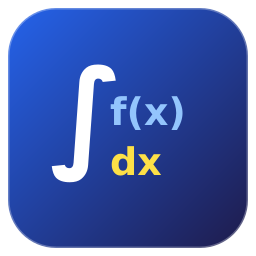

<div align="center">

[English](README.md) | [Tiếng Việt](README.vi.md)

<br />
<br />



# MathWeave Studio

**Không gian làm việc toán học tương tác hỗ trợ giải toán từng bước sư phạm, kiểm chứng ký hiệu độc lập và trực quan hóa 2D/3D.**

*MathWeave Studio được xây dựng nhằm giúp học sinh, sinh viên và người nghiên cứu thấu hiểu chuỗi lập luận và quy tắc biến đổi toán học, thay vì xem phần mềm tính toán như một "hộp đen" chỉ trả về đáp số cuối cùng.*

[](LICENSE)
[](https://www.python.org/)
[](pyproject.toml)

</div>

---

## Tổng quan dự án

Hầu hết các phần mềm toán học hiện nay chỉ đưa ra đáp án sau cùng, khiến người học gặp khó khăn trong việc hiểu rõ cách thức dẫn đến kết quả hoặc kiểm chứng tính đúng đắn của từng bước trung gian.

MathWeave Studio giải quyết vấn đề này bằng cách kết hợp:
- **Đại số ký hiệu chính xác:** Xử lý tính toán đại số chính xác tuyệt đối với SymPy.
- **Bộ máy phân rã từng bước sư phạm:** Tách bạch các quy tắc giải tích chuẩn mực (Quy tắc lũy thừa, tổng, hiệu, tích, thương, hàm hợp, lượng giác...) kèm các bước con (*Substeps*) có thể mở rộng.
- **Kiểm chuẩn độc lập hai tầng:** Mọi lời giải đều được đối chiếu chéo độc lập bằng đại số biểu tượng và lấy mẫu số học đa điểm (*Numerical Probing*).
- **Trực quan hóa tương tác:** Đồ thị hàm số 2D tự động phát hiện tiệm cận và điểm gián đoạn, đồ thị mặt cong 3D chuẩn màu hệ trục và bảng biến thiên toán học.

> **Lưu ý về phiên bản:** MathWeave Studio hiện đang trong giai đoạn phát triển tích cực (`MVP · v0.1.0`). Việc đẩy commit lên GitHub chưa tự động tạo phiên bản phát hành mới; một GitHub Release kèm Git tag tương ứng phải được tạo chính thức để các huy hiệu phát hành cập nhật tự động.

---

<!-- VỊ TRÍ HÌNH ẢNH MINH HỌA / DEMO: Ảnh chụp màn hình ứng dụng thực tế hoặc video demo sẽ được đặt tại đây sau khi được lưu trữ trong thư mục assets của kho lưu trữ. -->

## Các tính năng chính

### Giải tích (Calculus)
- **Đạo hàm:** Đạo hàm bậc 1 và cấp cao $f^{(n)}(x)$ (từ cấp 1 đến cấp 10); đạo hàm riêng hàm nhiều biến ($\frac{\partial f}{\partial x}$, $\frac{\partial f}{\partial y}$).
- **Tích phân:** Nguyên hàm (tích phân bất định) kèm quy tắc và hằng số tích phân $+ C$; tích phân xác định trên đoạn $[a, b]$ theo định lý Newton–Leibniz.
- **Giới hạn hàm số (Limits):** Giới hạn hai phía và một phía ($\lim_{x \to a^{\pm}}$) tại điểm hữu hạn và vô cực ($\pm\infty$).
- **Giải tích đa biến & Hình học:** Độ dài cung, diện tích mặt cong, mặt/khối tròn xoay, tích phân đường, tích phân mặt và tích phân khối (Descartes, trụ, cầu).

### Đại số tuyến tính (Linear Algebra)
- **Định thức (Determinants):** Công thức $2 \times 2$ và khai triển Laplace cho ma trận bậc cao.
- **Ma trận nghịch đảo ($A^{-1}$):** Kiểm tra điều kiện khả nghịch ($\det A \ne 0$) và tính qua ma trận phụ hợp.
- **Dạng bậc thang:** Thuật toán khử Gauss (REF) và khử Gauss–Jordan (RREF) với các phép biến đổi hàng sơ cấp.
- **Các phép toán ma trận:** Cộng, trừ, nhân hai ma trận ($A \times B$) và chuyển vị ($A^T$).
- **Giải hệ phương trình tuyến tính ($Ax = b$):** Thiết lập ma trận mở rộng $[A | b]$ và biện luận nghiệm.

### Kiểm chuẩn & Ràng buộc toán học
- **Kiểm chứng độc lập hai tầng:** Hiển thị huy hiệu kiểm định (*Verified* qua đối chiếu biểu tượng hoặc *Numerical Probe* với sai số $< 10^{-9}$).
- **Điều kiện xác định ($\mathcal{D}$):** Tự động phát hiện mẫu số triệt tiêu, biểu thức dưới căn bậc hai không âm và điểm kỳ dị của hàm lượng giác.

### Trực quan hóa & Bảng biến thiên
- **Đồ thị 2D (Plotly):** Tương tác thu phóng, kéo rê và tự động nhận diện tiệm cận đứng để tránh nối dây sai qua nhánh vô cực.
- **Đồ thị 3D không gian:** Trực quan hóa mặt cong và đường cong không gian với hệ trục tọa độ RGB chuẩn hóa (Trục X = Đỏ, Trục Y = Xanh lá, Trục Z = Xanh dương).
- **Bảng biến thiên:** Trình bày chuẩn học thuật hiển thị tập xác định $\mathcal{D}$, điểm tới hạn, điểm gián đoạn (vạch kép `||`), dấu đạo hàm và mũi tên chiều biến thiên.

---

## Cài đặt và Khởi động nhanh

MathWeave Studio được phát triển và kiểm chuẩn chính trên môi trường **Arch Linux**.

### Khởi động nhanh trên Arch Linux (qua uv)

1. **Sao chép mã nguồn kho lưu trữ:**
   ```bash
   git clone https://github.com/TqvNoCode/MathWeave-Studio.git
   cd MathWeave-Studio
   ```

2. **Đồng bộ các gói phụ thuộc:**
   ```bash
   uv sync
   ```

3. **Khởi chạy ứng dụng:**
   ```bash
   uv run run.py --browser
   ```

Mở trình duyệt web tại: **[http://localhost:8080](http://localhost:8080)**

Để xem hướng dẫn chi tiết trên Arch Linux—bao gồm trạng thái gói AUR/yay, gói hệ thống, chạy với môi trường ảo tiêu chuẩn và cách gỡ cài đặt sạch sẽ—vui lòng xem [Hướng dẫn cài đặt trên Arch Linux](docs/INSTALL_ARCH.md).

---

## Tài liệu dự án

- 🐧 **[Hướng dẫn cài đặt Arch Linux (INSTALL_ARCH.md)](docs/INSTALL_ARCH.md):** Hướng dẫn chi tiết cho người dùng Arch Linux, trạng thái yay/AUR, cài đặt từ mã nguồn và gỡ cài đặt an toàn.
- 📖 **[Hướng dẫn sử dụng (USER_GUIDE.md)](docs/USER_GUIDE.md):** Tài liệu hướng dẫn thực hành 5 bước, các ví dụ đại diện, cú pháp nhập liệu và xử lý lỗi.

---

## Phát triển và Bộ kiểm thử

MathWeave Studio duy trì bộ kiểm thử tự động toàn diện kiểm soát ranh giới kiến trúc Clean Architecture, tính chính xác của các thuật toán và độ ổn định của giao diện:

```bash
# Chạy toàn bộ 190 bài kiểm thử tự động
uv run pytest
```

Toàn bộ 190 bài kiểm thử đều vượt qua với tỷ lệ thành công 100%.

---

## Bản quyền & Tác giả

- **Giấy phép:** Giấy phép GNU General Public License v3.0 ([GPL-3.0](LICENSE)).
- **Tác giả:** TQV (`TqvNoCode` — `chienthuatcovua2@gmail.com`)
- **Bản quyền:** `© 2026 by TQV`
