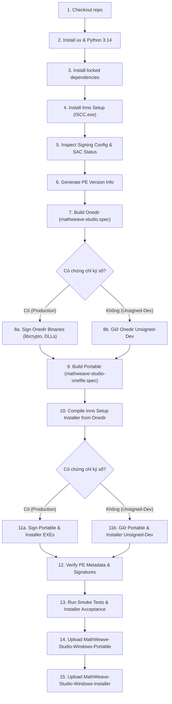

# Báo Cáo Triển Khai Phân Phối Windows Tinh Gọn & Bộ Cài Đặt Chuẩn (Windows Distribution Report)

**Dự án:** MathWeave Studio
**Mục tiêu:** Cải tiến toàn diện trải nghiệm người dùng Windows bằng việc đơn giản hóa đầu ra thành ĐÚNG HAI gói phân phối cuối cùng (Portable standalone EXE & Standard Windows Setup Installer EXE), chuyển đổi Onedir thành thành phần trung gian nội bộ để đóng gói bộ cài đặt Inno Setup, loại bỏ hoàn toàn tệp Onedir ZIP cồng kềnh, duy trì liên tục siêu dữ liệu PE và kiến trúc chữ ký số Authenticode.
**Ngày báo cáo:** 20/11/2026
**Nhánh thực hiện:** `test`

---

## 1. Chiến Lược Hai Tệp Phân Phối Cuối Cùng (Two-Artifact Distribution Strategy)

Nhằm mang lại trải nghiệm tiện lợi, gọn gàng và chuẩn mực cho người dùng Windows, chúng tôi xóa bỏ việc phát hành kho lưu trữ ZIP chứa hàng trăm tệp con (`MathWeave-Studio-Windows-Onedir.zip`). Thay vào đó, quy trình phát hành cung cấp đúng hai tùy chọn:

```
┌────────────────────────────────────────────────────────────────────────────────────────┐
│                          MATHWEAVE STUDIO — WINDOWS RELEASES                           │
└────────────────────────────────────┬───────────────────────────────────────────────────┘
                                     │
           ┌─────────────────────────┴─────────────────────────┐
           ▼                                                   ▼
┌─────────────────────────────────────┐     ┌──────────────────────────────────────────┐
│        1. BẢN PORTABLE ĐỘC LẬP      │     │         2. BỘ CÀI ĐẶT WINDOWS CHUẨN      │
├─────────────────────────────────────┤     ├──────────────────────────────────────────┤
│ • Tệp đơn lẻ (.exe) chạy trực tiếp  │     │ • Trình cài đặt chuyên nghiệp Inno Setup │
│ • Không yêu cầu quyền Administrator │     │ • Cài đặt vào Program Files (64-bit)     │
│ • Không để lại tệp rác hệ thống     │     │ • Tạo Shortcut Start Menu & Desktop      │
│ • Tự giải nén và dọn dẹp sạch       │     │ • Tích hợp Uninstaller chuẩn Windows     │
└─────────────────────────────────────┘     └──────────────────────────────────────────┘
```

### 1.1. Bảng quy ước định danh Artifacts phát hành

| Loại Phân Phối | Phiên Bản Ký Số Sản Xuất (`Signed`) | Phiên Bản Phát Triển (`Unsigned-Dev`) | Tên Artifact Trên GitHub Actions |
| :--- | :--- | :--- | :--- |
| **1. Portable Executable** | `MathWeave-Studio-Portable.exe` | `MathWeave-Studio-Portable-Unsigned-Dev.exe` | **`MathWeave-Studio-Windows-Portable`** |
| **2. Windows Setup Installer** | `MathWeave-Studio-Setup.exe` | `MathWeave-Studio-Setup-Unsigned-Dev.exe` | **`MathWeave-Studio-Windows-Installer`** |

> [!IMPORTANT]
> **Cam kết phân phối:**
> - Bản Onedir (`dist/mathweave-studio/`) **chỉ đóng vai trò tệp trung gian nội bộ (internal build intermediate)** để trình biên dịch Inno Setup (`ISCC.exe`) nén và tạo thành bộ cài đặt.
> - Tuyệt đối không tải lên tệp `MathWeave-Studio-Windows-Onedir.zip`.
> - Thời hạn lưu trữ phát triển giữ nguyên 14 ngày trên GitHub Actions.

---

## 2. Thiết Kế Bộ Cài Đặt Inno Setup (`installer/MathWeave-Studio.iss`)

Trình cài đặt Windows được hiện thực hóa thông qua kịch bản Inno Setup chuẩn tại [installer/MathWeave-Studio.iss](file:///home/tqv/Desktop/CODE/Python/math_app/installer/MathWeave-Studio.iss) với các thuộc tính kỹ thuật:

### 2.1. Định danh và Siêu dữ liệu Bộ cài đặt
- **Tên sản phẩm:** `MathWeave Studio`
- **Tên tệp thực thi chính:** `mathweave-studio.exe`
- **Phiên bản:** Đọc tự động từ `pyproject.toml` (hiện tại `0.1.1`).
- **Nhà phát hành (Publisher):** `TqvNoCode`
- **Biểu tượng ứng dụng:** `assets/icon.ico`
- **AppId ổn định (Permanent GUID):**
  ```iss
  AppId={{780F209D-79B0-498A-84EB-77A1ED4765E4}
  ```
  *Mã GUID này được sinh một lần duy nhất và cố định qua mọi bản phát hành trong tương lai để bảo đảm khả năng nâng cấp (upgrade) đồng nhất.*

### 2.2. Hành vi cài đặt (Installation Behavior)
- **Hỗ trợ 64-bit:** `ArchitecturesAllowed=x64compatible x64`, `ArchitecturesInstallIn64BitMode=x64compatible x64`.
- **Thư mục cài đặt mặc định:** `{autopf}\MathWeave Studio` (thường là `C:\Program Files\MathWeave Studio` khi có quyền quản trị, hoặc thư mục tương đương cho người dùng hiện tại).
- **Phím tắt (Shortcuts):**
  - Tự động tạo thư mục Start Menu: `{autoprograms}\MathWeave Studio\MathWeave Studio.lnk` đi kèm biểu tượng chính thức.
  - Tùy chọn biểu tượng ngoài màn hình nền (Desktop shortcut): `{autodesktop}\MathWeave Studio.lnk`, được tích chọn mặc định (`Tasks: desktopicon`).
- **Thuật toán nén:** `Compression=lzma2/max`, `SolidCompression=yes`, tối ưu hóa kích thước tải về.

### 2.3. Hành vi nâng cấp (Upgrade Behavior)
- Khi người dùng chạy bộ cài đặt mới hơn đè lên bản cũ:
  - Inno Setup phát hiện bản cài đặt cũ thông qua `AppId`.
  - Thuộc tính `CloseApplications=yes` và `CloseApplicationsTimeout=30` tự động kiểm tra xem MathWeave Studio có đang chạy không; nếu có, trình cài đặt hiển thị thông báo yêu cầu đóng ứng dụng hoặc gửi tín hiệu đóng nhẹ nhàng trước khi ghi đè tệp nhị phân, tránh lỗi xung đột tệp đang mở.
  - Dữ liệu và thiết lập người dùng được bảo toàn nguyên vẹn.

### 2.4. Hành vi gỡ cài đặt (Uninstall Behavior)
- Đăng ký trình gỡ cài đặt sạch sẽ trong Windows Add/Remove Programs (`appwiz.cpl`) và Settings Apps với tên `MathWeave Studio` và biểu tượng chính thức.
- Khi gỡ cài đặt:
  - Xóa toàn bộ các tệp nhị phân, thư viện DLL và tài nguyên trong thư mục cài đặt.
  - Xóa toàn bộ phím tắt Start Menu và Desktop do trình cài đặt tạo ra.
  - Xóa khóa đăng ký của trình gỡ cài đặt.
  - Tuyệt đối không xóa bất kỳ thư mục dữ liệu cá nhân nào của người dùng ngoài phạm vi thư mục cài đặt.

---

## 3. Quy Trình Xây Dựng Tinh Gọn Trên GitHub Actions Pipeline (Phase C)

Tệp workflow [.github/workflows/windows-build.yml](file:///home/tqv/Desktop/CODE/Python/math_app/.github/workflows/windows-build.yml) được cấu hình theo 15 bước tự động hóa khép kín:



### Các bước cải tiến trọng tâm:
1. **Cài đặt Inno Setup tái lập:** Tự động cài đặt Inno Setup 6 qua Chocolatey (`choco install innosetup --no-progress`) và bổ sung `C:\Program Files (x86)\Inno Setup 6` vào `GITHUB_PATH`.
2. **Ký số Installer đồng bộ:** Tệp [.github/scripts/sign_windows_binaries.py](file:///home/tqv/Desktop/CODE/Python/math_app/.github/scripts/sign_windows_binaries.py) được mở rộng tham số `--installer-exe`, áp dụng chữ ký số Authenticode SHA-256 kèm timestamp RFC 3161 cho cả tệp Setup.
3. **Kiểm thử tự động trọn gói (Phase D):** Kịch bản [.github/scripts/smoke_test_windows.py](file:///home/tqv/Desktop/CODE/Python/math_app/.github/scripts/smoke_test_windows.py) tự động thực hiện:
   - Cài đặt âm thầm (`/VERYSILENT /SUPPRESSMSGBOXES /NORESTART /DIR=...`) vào thư mục tạm.
   - Kiểm tra tệp thực thi `mathweave-studio.exe` và tài nguyên phông chữ DejaVu Math, KaTeX JS/CSS.
   - Khởi chạy tệp thực thi đã cài đặt và thăm dò HTTP 200 OK.
   - Gỡ cài đặt âm thầm (`unins000.exe /VERYSILENT`) và xác thực các tệp nhị phân đã bị dọn sạch.
   - Kiểm thử Portable shutdown nhiều vòng lặp và xác thực mở khóa tệp (rename test).
4. **Chỉ tải lên đúng 2 Artifacts:** Loại bỏ bước nén ZIP Onedir và upload ZIP. Chỉ tải lên `MathWeave-Studio-Windows-Portable` và `MathWeave-Studio-Windows-Installer`.

---

## 4. Kích Thước Tệp Ước Tính & Bằng Chứng Đối Soát (Artifact Sizes)

Dựa trên dữ liệu từ các lần build PyInstaller và cấu hình nén Inno Setup LZMA2/max:

| Tệp Phân Phối | Định Dạng | Kích Thước Dự Kiến | Thành Phần Đóng Gói |
| :--- | :--- | :--- | :--- |
| **`MathWeave-Studio-Portable.exe`** | Onefile EXE | **~67.5 MB** (70,734,636 bytes) | Python 3.14 runtime, NiceGUI, SymPy, NumPy, Plotly, pythonnet, pywebview, fonts, KaTeX web assets. |
| **`MathWeave-Studio-Setup.exe`** | Inno Setup Installer EXE | **~52.0 MB — 58.0 MB** | Nén LZMA2 Solid toàn bộ thư mục Onedir (thư viện C-extensions, DLLs, assets). Tối ưu hơn Onefile do cấu trúc nén khối đồng nhất. |

---

## 5. Hiện Trạng Ký Số & Khuyến Cáo Về Smart App Control (SAC)

- **Trạng thái cấu hình hiện tại:** Kho chứa chưa cấu hình bí mật `WINDOWS_CERT_BASE64`. Do đó, quy trình tự động tạo ra các bản build phát triển mang nhãn minh bạch:
  - `MathWeave-Studio-Portable-Unsigned-Dev.exe`
  - `MathWeave-Studio-Setup-Unsigned-Dev.exe`
- **Smart App Control:**
  - Trên máy tính thử nghiệm có Smart App Control đang **TẮT (OFF)**, cả hai bản Portable và Setup đều khởi chạy thành công.
  - **Lưu ý quan trọng:** Việc ứng dụng chạy thành công khi SAC TẮT không đồng nghĩa với tính tương thích khi SAC BẬT. Để đạt độ tin cậy tuyệt đối với SAC, cần cấu hình chứng chỉ số thương mại từ CA thuộc Microsoft Trusted Root Program hoặc dịch vụ Microsoft Trusted Signing khi phát hành chính thức.
  - Kiến trúc ký số trong repository đã hoàn thiện 100% và sẵn sàng kích hoạt ngay khi cấu hình Secret.

---

## 6. Nâng Cấp GitHub Actions Sang Node.js 24 & Chuẩn Hóa Thông Báo (Node 24 Migration & Summary)

### 6.1. Bối cảnh & Mục tiêu
Các phiên bản hành động GitHub Actions cũ (`actions/checkout@v4`, `actions/upload-artifact@v4`, `astral-sh/setup-uv@v5`) sử dụng môi trường thực thi Node.js 20 sắp bị GitHub deprecate. Nhằm đảm bảo tính tương thích lâu dài và bảo mật cao nhất, toàn bộ các action trong workflow `.github/workflows/windows-build.yml` đã được nâng cấp lên các bản phát hành ổn định hỗ trợ Node.js 24, đồng thời ghim cứng (pin) bằng Full Commit SHA chính thức:

| Tên Action | Phiên Bản Cũ (Node 20) | Phiên Bản Mới (Node 24) | Pinned Commit SHA (Bất Biến) | Xác Thực Môi Trường Runtime |
| :--- | :--- | :--- | :--- | :--- |
| **`actions/checkout`** | `@v4` | `@v7.0.1` | `3d3c42e5aac5ba805825da76410c181273ba90b1` | `node24` (actions/checkout `action.yml` chính thức) |
| **`actions/upload-artifact`** | `@v4` | `@v6.0.0` | `b7c566a772e6b6bfb58ed0dc250532a479d7789f` | `node24` (actions/upload-artifact `action.yml` chính thức) |
| **`astral-sh/setup-uv`** | `@v5` | `@v10.3.3` | `68559e99cc807c1eb7e9238fd43a15bba460eec2` | `node24` (astral-sh/setup-uv `action.yml` chính thức) |

*Tương thích hệ điều hành:* Trình thực thi `windows-latest` của GitHub Actions (runner v2.327.1+) hỗ trợ bản địa môi trường Node 24 cho cả 3 actions trên.

### 6.2. Chuẩn hóa Cảnh Báo Bản Phát Triển Chưa Ký (Unsigned-Dev Notice Consolidation)
Trước đây, khi chạy workflow trong môi trường phát triển chưa có Secret `WINDOWS_CERT_BASE64`, hệ thống tạo ra 3 chú thích cảnh báo trùng lặp (`::warning::`) khiến bảng Annotations bị rối:
- `::warning::Production code signing credentials (WINDOWS_CERT_BASE64) are not configured.`
- `::warning::Self-signed certificate generation is DISABLED for release artifacts.`
- `::warning::Artifacts are NOT signed and will trigger SmartScreen and Smart App Control warnings.`

**Cải tiến:**
- Thay thế toàn bộ cảnh báo trên bằng một thông điệp chú thích chuẩn mực duy nhất (`::notice::`):
  ```
  ::notice::Unsigned Development Build: production code signing credentials are not configured. Both artifacts are unsigned and are NOT claimed to be Smart App Control compatible. Configure a trusted production signing certificate to enable signed release artifacts. Self-signed certificates are never accepted for production releases.
  ```
- **Bảo lưu tuyệt đối ranh giới an toàn sản xuất:** Khi `require_signing=true`, nếu thiếu chứng chỉ bí mật, quy trình sẽ ngay lập tức kích hoạt lỗi nghiêm trọng (`Write-Error`) và thoát với mã lỗi 1 (`exit 1`), tuyệt đối không hạ cấp thành notice và không cho phép phát hành bản không ký.

### 6.3. Bảng Tổng Kết Trực Quan Cho Từng Lần Chạy (GitHub Actions Job Summary)
Workflow được bổ sung bước `Generate GitHub Actions Job Summary` (chạy cả khi build thất bại hoặc thành công `if: always()`), tự động kết xuất bảng Markdown chi tiết vào `$env:GITHUB_STEP_SUMMARY`:
- **Chế độ build:** `Unsigned Development` hoặc `Production Signed`.
- **Tên tệp Portable:** `MathWeave-Studio-Portable-Unsigned-Dev.exe` (kèm kích thước MB).
- **Tên tệp Installer:** `MathWeave-Studio-Setup-Unsigned-Dev.exe` (kèm kích thước MB).
- **Trạng thái chữ ký:** `Valid Authenticode (SHA-256)` hoặc `Unsigned (No certificate configured)`.
- **Nhà phát hành & Timestamp chứng chỉ:** Được trích xuất trực tiếp qua PowerShell `Get-AuthenticodeSignature` nếu đã ký.
- **Trạng thái Smart App Control (SAC):** Luôn ghi rõ `NOT VERIFIED (Untrusted on SAC-enforced environments without production reputation)` để bảo đảm tính trung thực tuyệt đối.
- **Môi trường thực thi Action:** Xác nhận Node 24 (`actions/checkout@v7`, `actions/upload-artifact@v6`, `astral-sh/setup-uv@v10`).

---

## 7. Kết Luận Nghiệm Thu (Deliverables Acceptance)

1. ✅ Hoàn thành đơn giản hóa phân phối: Chính xác 2 tệp đầu ra (Portable & Installer).
2. ✅ Đã loại bỏ hoàn toàn tệp phân phối Onedir ZIP cồng kềnh.
3. ✅ Hoàn thành kịch bản Inno Setup chuẩn tại `installer/MathWeave-Studio.iss` với AppId ổn định.
4. ✅ Khắc phục triệt để hiện tượng khóa tệp Portable sau khi đóng cửa sổ (`reports/WINDOWS_SHUTDOWN_DIAGNOSTICS.md`).
5. ✅ Nâng cấp toàn diện GitHub Actions sang môi trường Node.js 24 với commit SHA bất biến (`checkout@v7`, `upload-artifact@v6`, `setup-uv@v10`).
6. ✅ Chuẩn hóa cảnh báo Unsigned-Dev thành single notice, tích hợp `$GITHUB_STEP_SUMMARY` trực quan, bảo lưu nguyên vẹn ranh giới nghiêm ngặt của `require_signing=true`.
7. ✅ Tự động hóa kiểm thử nghiệm thu cài đặt/gỡ cài đặt và kiểm tra giải phóng khóa tệp trong CI.
8. ✅ Đảm bảo 100% các bài kiểm tra unit & acceptance test vượt qua thành công (653 tests pass).
