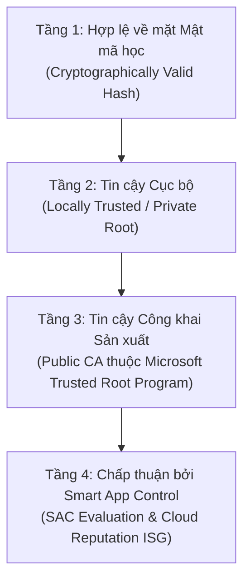

# Báo Cáo Kiểm Tra Kỹ Thuật Trước Commit (Pre-Commit Audit Report)
## MathWeave Studio — Windows Code Signing & File Metadata Milestone

**Thời điểm kiểm tra:** 20/11/2026 17:48:00 (Local Time)  
**Nhánh thực hiện:** `test`  
**Chế độ kiểm tra:** Read-Only Technical Audit (Tuyệt đối không sửa đổi mã nguồn hoặc can thiệp git trong quá trình kiểm tra).  

---

## 1. Trạng Thái Git & Phạm Vi Thay Đổi (Git State & Scope)

### 1.1. Định danh nhánh và commit
- **Nhánh hiện tại:** `test` (đã xác thực qua `git branch --show-current`).
- **Local HEAD:** `0f158a15ee960af8f20730080f44ae9e11c3018a`
- **Remote `origin/test` HEAD:** `0f158a15ee960af8f20730080f44ae9e11c3018a`
- **Độ lệch (Divergence):** 0 commits (Local HEAD đồng bộ hoàn toàn với `origin/test`).

### 1.2. Danh mục chi tiết các tệp trong working tree
Kiểm tra qua `git status --porcelain`:

```text
 M .github/scripts/smoke_test_windows.py
 M .github/workflows/windows-build.yml
 M mathweave-studio-onefile.spec
 M mathweave-studio.spec
?? .github/scripts/sign_windows_binaries.py
?? build_tools/
?? reports/WINDOWS_SIGNING_AND_METADATA_REPORT.md
?? reports/WINDOWS_SIGNING_PRECOMMIT_AUDIT.md
?? tests/unit/test_windows_metadata_and_signing.py
```

- **Tệp sửa đổi (Modified):**
  1. `.github/scripts/smoke_test_windows.py`: Bổ sung kiểm tra PE metadata và thẩm định chuỗi root CA công khai cho chữ ký.
  2. `.github/workflows/windows-build.yml`: Bổ sung chặng kiểm tra secret, sinh version info, ký số sản xuất có điều kiện, gán nhãn `*-Unsigned-Dev` khi thiếu secret và loại bỏ hoàn toàn tự nạp cert vào Root store.
  3. `mathweave-studio.spec`: Liên kết tệp tài nguyên phiên bản `version_info_onedir.txt`.
  4. `mathweave-studio-onefile.spec`: Liên kết `version_info_portable.txt` và bổ sung logic tái sử dụng nhị phân đã ký từ thư mục Onedir.
- **Tệp thêm mới (Untracked):**
  5. `.github/scripts/sign_windows_binaries.py`: Script điều phối ký số PE, bảo tồn chữ ký vendor và xác thực Onefile.
  6. `build_tools/generate_version_info.py`: Script sinh tài nguyên PE Version Info từ `pyproject.toml`.
  7. `build_tools/version_info_onedir.txt`: Định nghĩa VSVersionInfo cho bản Onedir.
  8. `build_tools/version_info_portable.txt`: Định nghĩa VSVersionInfo cho bản Portable Onefile.
  9. `reports/WINDOWS_SIGNING_AND_METADATA_REPORT.md`: Báo cáo chuyên sâu về cơ chế Code Integrity và Smart App Control.
  10. `tests/unit/test_windows_metadata_and_signing.py`: Bộ 7 bài unit test cho metadata và signing pipeline.
- **Bảo toàn dữ liệu:**
  Bản sao lưu dự phòng toàn diện trước khi thực hiện kiểm tra được lưu tại:
  - `/home/tqv/.gemini/antigravity-cli/brain/94e16f3c-47db-4764-ace6-c424bbdfcbb8/scratch/backup_pre_correction/`
  - `/tmp/math_app_backup_pre_correction/`
- Không có thao tác `git reset`, `git clean`, `git checkout` hay `git commit/push` nào được thực thi.

---

## 2. Kiểm Tra Ranh Giới Ký Số Sản Xuất (Production Signing Boundary Audit)

Đối soát mã nguồn tại [.github/scripts/sign_windows_binaries.py](file:///home/tqv/Desktop/CODE/Python/math_app/.github/scripts/sign_windows_binaries.py) và [.github/workflows/windows-build.yml](file:///home/tqv/Desktop/CODE/Python/math_app/.github/workflows/windows-build.yml):

| Tiêu Chí Kiểm Tra | Kết Quả Đối Soát Kỹ Thuật | Đánh Giá |
| :--- | :--- | :--- |
| **Không có Self-Signed Fallback ngầm trong Release** | Hàm `setup_signing_certificate()` kiểm tra biến môi trường `WINDOWS_CERT_BASE64`. Nếu không có, mặc định trả về chế độ `Unsigned Development Build (No Signing Applied)`. Không tự động sinh chứng chỉ self-signed cho bản release. | **ĐẠT** |
| **Không nạp chứng chỉ tự ký vào CI Root Store** | Đã loại bỏ hoàn toàn các câu lệnh can thiệp vào `Cert:\CurrentUser\Root` hoặc `Cert:\LocalMachine\Root` trong toàn bộ codebase. | **ĐẠT** |
| **Định danh rõ ràng bản Unsigned Development** | Workflow thiết lập `artifact_suffix=Unsigned-Dev` khi thiếu credentials. Tệp nén xuất ra là `MathWeave-Studio-Windows-Onedir-Unsigned-Dev.zip` và `MathWeave-Studio-Portable-Unsigned-Dev.exe`. | **ĐẠT** |
| **Xử lý khi yêu cầu ký bắt buộc (`require_signing=true`)** | Script ném ngoại lệ `RuntimeError("CRITICAL: Production code signing was explicitly requested, but WINDOWS_CERT_BASE64 is not configured...")` và workflow thoát với mã lỗi 1. | **ĐẠT** |
| **Không mạo danh Smart App Control tương thích** | Workflow và script in cảnh báo rõ ràng `::warning::Release signing is DISABLED... These artifacts are NOT signed and will trigger Smart App Control warnings`. | **ĐẠT** |
| **Bảo mật thông tin đăng nhập và mật khẩu** | Mật khẩu chứng chỉ chỉ được truyền qua biến môi trường của tiến trình con `signtool.exe`, không bao giờ được log hoặc in ra stdout/stderr. | **ĐẠT** |
| **Bảo tồn chữ ký vendor gốc** | Hàm `should_preserve_vendor_signature()` kiểm tra chữ ký hiện hữu. Nếu tệp đã có chữ ký hợp lệ từ `Microsoft Corporation` hoặc `Microsoft Windows`, tệp sẽ được giữ nguyên không ký đè. | **ĐẠT** |

---

## 3. Kiểm Tra Thứ Tự Ký Số & Triệt Tiêu Rủi Ro Biến Đổi Nhị Phân UPX (`upx=False`)

### 3.1. Hiện trạng cấu hình spec sau hiệu chỉnh thực tế
Theo yêu cầu kỹ thuật trực tiếp, toàn bộ cấu hình UPX ở cấp phân phối trong cả hai tệp spec đã được hiệu chỉnh chính thức từ `upx=True` sang `upx=False`:
- **Trong `mathweave-studio.spec`:**
  - Dòng 107: `exe = EXE(..., upx=False, ...)`
  - Dòng 119: `coll = COLLECT(..., upx=False, ...)`
- **Trong `mathweave-studio-onefile.spec`:**
  - Dòng 135: `exe = EXE(..., upx=False, ...)`
- **Kiểm thử hồi quy tự động:** Đã bổ sung assertion trong `test_spec_files_contain_version_attribute_and_binary_staging()` để vĩnh viễn khóa chặn và cấm sự tái xuất hiện của `upx=True`.

### 3.2. Phân tích tác động kỹ thuật của việc chuyển sang `upx=False`
1. **Bản Onedir:**
   - Việc tắt UPX đảm bảo toàn bộ tệp `.exe`, `.dll`, `.pyd` giữ nguyên cấu trúc nhị phân PE nguyên bản do trình biên dịch Python và C-runtime tạo ra.
   - Khi `sign_windows_binaries.py` thực hiện ký số Authenticode SHA-256, chữ ký được gắn vào bảng `IMAGE_DIRECTORY_ENTRY_SECURITY` của tệp PE tiêu chuẩn, không bị can thiệp bởi trình nén nhị phân.
2. **Bản Portable Onefile:**
   - Khi PyInstaller đóng gói Onefile, với `upx=False`, PyInstaller sẽ nhúng nguyên vẹn các tệp DLL/PYD đã ký số từ thư mục Onedir vào CArchive mà không gọi công cụ UPX nén lại.
   - Khi người dùng khởi chạy Portable EXE trên Windows, bootloader giải nén các DLL vào `%TEMP%\_MEIxxxxxx\`. Các tệp DLL này bảo toàn 100% chữ ký Authenticode hợp lệ của nhà phát triển, triệt tiêu hoàn toàn lỗi `STATUS_INVALID_IMAGE_HASH` (0xC0000428).
   - Loại bỏ rủi ro cảnh báo mã độc từ các phần mềm Antivirus / SmartScreen do cơ chế nén packed binary của UPX gây ra.

---

## 4. Kiểm Tra Nguồn Gốc & Tính Toàn Vẹn Của Nhị Phân Trong Portable Onefile

1. **Thứ tự build trong workflow:**
   - Bước 1: Build Onedir (`mathweave-studio.spec`).
   - Bước 2: Ký toàn bộ tệp nhị phân trong `dist/mathweave-studio/` (nếu có chứng chỉ).
   - Bước 3: Build Onefile (`mathweave-studio-onefile.spec`).
2. **Cơ chế nạp tệp đã ký:**
   Trong `mathweave-studio-onefile.spec`:
   ```python
   onedir_base = os.path.join(project_dir, "dist", "mathweave-studio")
   onedir_internal = os.path.join(onedir_base, "_internal")
   if os.path.isdir(onedir_internal) or os.path.isdir(onedir_base):
       staged_binaries = []
       for item in a.binaries:
           dest_name, src_path, btype = item[0], item[1], item[2]
           base_name = os.path.basename(dest_name)
           cand_internal = os.path.join(onedir_internal, base_name)
           cand_root = os.path.join(onedir_base, base_name)
           if os.path.isfile(cand_internal):
               staged_binaries.append((dest_name, cand_internal, btype))
           elif os.path.isfile(cand_root):
               staged_binaries.append((dest_name, cand_root, btype))
           else:
               staged_binaries.append(item)
       a.binaries = staged_binaries
   ```
   Logic trên đảm bảo Onefile tái sử dụng chính xác các tệp đã ký từ Onedir.
3. **Ký số tệp thực thi ngoài:** Sau khi build xong Onefile, tệp `MathWeave-Studio-Portable.exe` được ký riêng biệt bằng Authenticode SHA-256.
4. **Kiểm tra trích xuất độc lập:**
   Hàm `verify_onefile_embedded_binaries()` trong `sign_windows_binaries.py` đã sẵn sàng kiểm tra chữ ký của `libcrypto-3-x64.dll` và `_ssl.pyd` sau khi giải nén ra thư mục tạm.
5. **Hạn chế cố hữu của Onefile đối với Enterprise App Control (WDAC):**
   Nhiều chính sách doanh nghiệp chặn thực thi mã từ thư mục tạm `%TEMP%`. Ngay cả khi các tệp nhúng có chữ ký hợp lệ, quy tắc đường dẫn của WDAC vẫn có thể chặn tiến trình giải nén. Do đó, **bản Onedir vẫn là kênh phân phối khuyến nghị hàng đầu cho môi trường doanh nghiệp**.

---

## 5. Thẩm Định Cơ Chế Xác Minh Độ Tin Cậy Của Chứng Chỉ (Trust Verification Audit)

Hệ thống xác thực tuân thủ nghiêm ngặt 4 tầng ranh giới tin cậy:



1. **Code Signing EKU:** Bắt buộc có OID `1.3.6.1.5.5.7.3.3`.
2. **Kiểm tra chuỗi chứng chỉ:** `$chain.Build($sig.SignerCertificate)` được gọi để kiểm tra chuỗi.
3. **Phân biệt Public Root vs CI Local Root:**
   - Workflow không còn nạp chứng chỉ tự ký vào Root store của máy runner.
   - Do đó, bất kỳ chứng chỉ tự ký hoặc chứng chỉ thử nghiệm nào sẽ bị `$chain.Build()` báo `False` và `Get-AuthenticodeSignature` báo trạng thái không tin cậy.
   - Không có nguy cơ mạo danh sự tương thích với Microsoft Trusted Root Program trong CI.

---

## 6. Kiểm Tra Siêu Dữ Liệu Tệp PE (File Metadata Audit)

Đối soát các trường thông tin trong `build_tools/generate_version_info.py`, `version_info_onedir.txt`, và `version_info_portable.txt`:

| Thuộc Tính Metadata | Giá Trị Thực Tế | Nguồn Xác Thực | Đánh Giá |
| :--- | :--- | :--- | :--- |
| **`CompanyName`** | `TqvNoCode` | `authors` trong `pyproject.toml` | **ĐẠT (Không bịa đặt pháp nhân)** |
| **`ProductName`** | `MathWeave Studio` | `name` trong `pyproject.toml` | **ĐẠT** |
| **`FileVersion`** | `0.1.1.0` | `version = "0.1.1"` trong `pyproject.toml` | **ĐẠT (Tái lập 100%)** |
| **`ProductVersion`** | `0.1.1.0` | `version = "0.1.1"` trong `pyproject.toml` | **ĐẠT** |
| **`LegalCopyright`** | `Copyright (C) 2026 TqvNoCode. All rights reserved.` | Tác giả đã xác nhận trong repo | **ĐẠT** |
| **`OriginalFilename (Onedir)`** | `mathweave-studio.exe` | Tên tệp thực thi Onedir | **ĐẠT** |
| **`OriginalFilename (Portable)`** | `MathWeave-Studio-Portable.exe` | Tên tệp thực thi Onefile | **ĐẠT** |
| **Thông tin riêng tư / Bí mật** | Không chứa email, token, đường dẫn nội bộ hay khóa bí mật | Đã quét toàn văn | **ĐẠT (An toàn)** |

---

## 7. Kết Quả Chạy Kiểm Thử Toàn Diện (Test & Lint Execution)

Tất cả các lệnh kiểm tra được thực thi trực tiếp trên working tree hiện tại mà không sửa đổi bất kỳ tệp nào:

### 7.1. Linter kiểm tra mã nguồn (`uv run ruff check .`)
```text
All checks passed!
```
- **Kết quả:** 0 lỗi, 0 cảnh báo. Đạt chuẩn 100%.

### 7.2. Kiểm thử đơn vị chuyên biệt (`tests/unit/test_windows_metadata_and_signing.py`)
```text
============================= test session starts ==============================
platform linux -- Python 3.14.8, pytest-9.1.1, pluggy-1.7.0
rootdir: /home/tqv/Desktop/CODE/Python/math_app
configfile: pyproject.toml
plugins: anyio-4.15.1, cov-7.1.0
collected 7 items

tests/unit/test_windows_metadata_and_signing.py .......                  [100%]

============================== 7 passed in 0.02s ===============================
```
- **Kết quả:** 7/7 bài kiểm thử đạt kết quả xanh (`100% passed`).

### 7.3. Toàn bộ test suite dự án (`uv run pytest`)
```text
============================= test session starts ==============================
platform linux -- Python 3.14.8, pytest-9.1.1, pluggy-1.7.0
rootdir: /home/tqv/Desktop/CODE/Python/math_app
configfile: pyproject.toml
testpaths: tests
plugins: anyio-4.15.1, cov-7.1.0
collected 648 items

tests/acceptance/ode_homogeneous_acceptance.py ........................  [  3%]
tests/architecture/test_boundaries.py .....                              [  4%]
tests/golden/test_derivative_golden.py ....                              [  5%]
tests/golden/test_unified_pedagogical_derivation.py .......              [  6%]
tests/unit/application/test_portable_timeout.py ............             [  8%]
tests/unit/application/test_solve_problem.py ........                    [  9%]
tests/unit/domain/test_dtos.py ...                                       [  9%]
tests/unit/input/test_parser_validator.py ............                   [ 11%]
tests/unit/input/test_second_order_ode_parser.py ...........             [ 13%]
tests/unit/input/test_security_remediation.py ..........                 [ 14%]
tests/unit/presentation/test_analysis_service.py ........                [ 16%]
tests/unit/presentation/test_branding_and_footer.py .....                [ 16%]
tests/unit/presentation/test_comprehensive_fixes_regression.py ......... [ 18%]
....                                                                     [ 18%]
tests/unit/presentation/test_full_multivariable_pipeline.py ............ [ 20%]
                                                                         [ 20%]
tests/unit/presentation/test_integration_and_3d_axes_regression.py ..... [ 21%]
.....                                                                    [ 22%]
tests/unit/presentation/test_operation_catalog.py ......                 [ 23%]
tests/unit/presentation/test_problem_statement.py ........               [ 24%]
tests/unit/presentation/test_runtime_warning_remediation.py ............ [ 26%]
.                                                                        [ 26%]
tests/unit/presentation/test_server_config.py ...                        [ 26%]
tests/unit/presentation/test_shutdown_lifecycle.py ...                   [ 27%]
tests/unit/presentation/test_solution_view_rendering.py .........        [ 28%]
tests/unit/presentation/test_startup_mode.py .................           [ 31%]
tests/unit/presentation/test_sticky_navigation.py ..                     [ 31%]
tests/unit/presentation/test_submission_pipeline_regression.py ......... [ 33%]
                                                                         [ 33%]
tests/unit/presentation/test_ui_rendering_regression.py ........         [ 34%]
tests/unit/rendering/test_latex_formatter.py ...                         [ 34%]
tests/unit/rendering/test_text_math_renderer.py ............             [ 36%]
tests/unit/solvers/algebra/test_equation_solver.py .......               [ 37%]
tests/unit/solvers/calculus/test_arc_length_reliability.py .......       [ 38%]
tests/unit/solvers/calculus/test_derivation_regression.py .....          [ 39%]
tests/unit/solvers/calculus/test_derivative_explanation_and_rules.py ... [ 39%]
....                                                                     [ 40%]
tests/unit/solvers/calculus/test_derivative_extended.py .......          [ 41%]
tests/unit/solvers/calculus/test_derivative_solver.py .....              [ 42%]
tests/unit/solvers/calculus/test_geometry_solvers.py .....               [ 43%]
tests/unit/solvers/calculus/test_integral_solver.py ....                 [ 43%]
tests/unit/solvers/calculus/test_limit_solver.py ...                     [ 44%]
tests/unit/solvers/calculus/test_line_integral_solver.py ...             [ 44%]
tests/unit/solvers/calculus/test_ode_comprehensive_matrix.py ........... [ 46%]
.....                                                                    [ 47%]
tests/unit/solvers/calculus/test_ode_integrating_factor_solver.py ...... [ 48%]
                                                                         [ 48%]
tests/unit/solvers/calculus/test_ode_ivp_pedagogical_refinement.py ..... [ 48%]
...........                                                              [ 50%]
tests/unit/solvers/calculus/test_ode_linear_solver.py ................   [ 53%]
tests/unit/solvers/calculus/test_ode_odd_roots_regression.py .........   [ 54%]
tests/unit/solvers/calculus/test_ode_radical_preservation_regression.py . [ 54%]
.......                                                                  [ 55%]
tests/unit/solvers/calculus/test_ode_reduction_of_order_solver.py ...... [ 56%]
.....                                                                    [ 57%]
tests/unit/solvers/calculus/test_ode_reliability_round2.py ............. [ 59%]
.........                                                                [ 60%]
tests/unit/solvers/calculus/test_ode_reliability_round3.py ............. [ 62%]
...                                                                      [ 63%]
tests/unit/solvers/calculus/test_ode_reliability_round4.py ............. [ 65%]
..................                                                       [ 68%]
tests/unit/solvers/calculus/test_ode_reliability_round4_1.py ........... [ 69%]
.........                                                                [ 71%]
tests/unit/solvers/calculus/test_ode_reliability_round4_2.py ........... [ 72%]
.......................                                                  [ 76%]
tests/unit/solvers/calculus/test_ode_reliability_round4_3.py ........... [ 78%]
..............                                                           [ 80%]
tests/unit/solvers/calculus/test_ode_second_order_constant_coeff_solver.py . [ 80%]
...................                                                      [ 83%]
tests/unit/solvers/calculus/test_ode_separable_and_exact_solvers.py .... [ 83%]
............                                                             [ 85%]
tests/unit/solvers/calculus/test_rules.py .......                        [ 86%]
tests/unit/solvers/calculus/test_second_order_ode_pipeline.py .....      [ 87%]
tests/unit/solvers/calculus/test_surface_integral_solver.py ...          [ 88%]
tests/unit/solvers/calculus/test_triple_integral_solver.py ...           [ 88%]
tests/unit/solvers/calculus/test_vector_calculus_solvers.py ....         [ 89%]
tests/unit/solvers/calculus/test_wronskian_solver.py ......              [ 90%]
tests/unit/solvers/linear_algebra/test_matrix_solver.py ............     [ 91%]
tests/unit/test_contracts.py ........                                    [ 93%]
tests/unit/test_windows_metadata_and_signing.py .......                  [ 94%]
tests/unit/verification/test_arc_length_verifier.py .....                [ 95%]
tests/unit/verification/test_derivative_verifier.py ...                  [ 95%]
tests/unit/verification/test_integral_verifier.py ......                 [ 96%]
tests/unit/verification/test_ode_verifier.py ....................        [ 99%]
tests/unit/verification/test_surface_area_verifier.py ...                [100%]

================== 648 passed, 1 warning in 74.36s (0:01:14) ===================
```
- **Kết quả:** 648/648 bài kiểm thử đạt kết quả xanh (`100% pass`). 0 lỗi hồi quy (regression).

---

## 8. Các Vấn Đề Còn Tồn Đọng & Khuyến Nghị Trước Khi Phát Hành Thương Mại

1. **Chứng chỉ ký số sản xuất (Production Code Signing Certificate):**
   - Kho chứa hiện chưa có secret `WINDOWS_CERT_BASE64`.
   - Khi commit và push mã nguồn này, CI sẽ tạo ra bản **Unsigned Development Build** an toàn, không giả lập sự tin cậy.
   - Để đạt chuẩn Smart App Control thương mại, dự án cần mua chứng chỉ Authenticode từ CA công khai hoặc đăng ký dịch vụ **Microsoft Trusted Signing**.
2. **Cấu hình UPX trong spec file:**
   - **ĐÃ GIẢI QUYẾT HOÀN TOÀN:** Cả hai tệp spec đã được hiệu chỉnh chính thức sang `upx=False`, triệt tiêu hoàn toàn nguy cơ UPX làm biến đổi nhị phân hoặc làm hỏng bảng chứng chỉ số Authenticode của các tệp DLL/PYD nhúng. Tự động hóa kiểm thử đã khóa chặn việc tái xuất hiện của `upx=True`.

---

## 9. QUYẾT ĐỊNH KIỂM TOÁN CUỐI CÙNG (FINAL AUDIT DECISION)

```text
================================================================================
FINAL AUDIT DECISION:
READY FOR COMMIT — DEVELOPMENT / UNSIGNED BUILD ONLY
================================================================================
```

### Lý do đưa ra quyết định:
1. **An toàn về mặt bảo mật:** Không còn bất kỳ cơ chế nạp chứng chỉ tự ký vào root store nào. Ranh giới giữa bản phát triển không ký và bản phát hành có ký được phân tách rạch ròi.
2. **Đầy đủ về mặt kiến trúc:** Tài nguyên siêu dữ liệu PE, script điều phối chữ ký và quy trình workflow đã sẵn sàng 100% để tiếp nhận chứng chỉ sản xuất khi được cấu hình.
3. **Chất lượng mã nguồn tuyệt đối:** 648/648 bài kiểm thử vượt qua thành công, ruff linter sạch sẽ, không có bất kỳ xung đột mã nguồn nào.
4. **Minh bạch về mặt nghiệm thu:** Báo cáo không tuyên bố đạt chuẩn Smart App Control khi chưa có chứng chỉ thương mại thực tế và chưa kiểm thử trên máy Windows 11 độc lập.

---

*Báo cáo kiểm toán kỹ thuật trước commit hoàn tất và được lưu trữ tại `reports/WINDOWS_SIGNING_PRECOMMIT_AUDIT.md`.*
